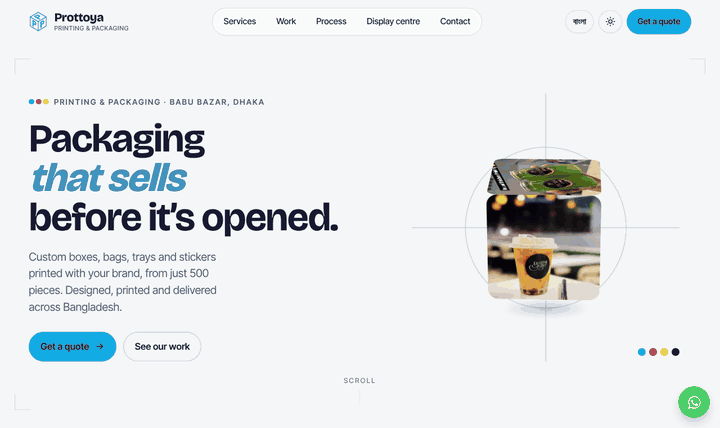
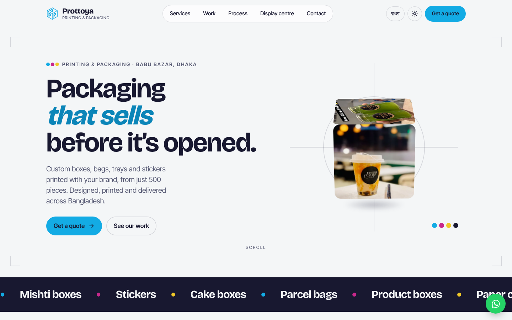
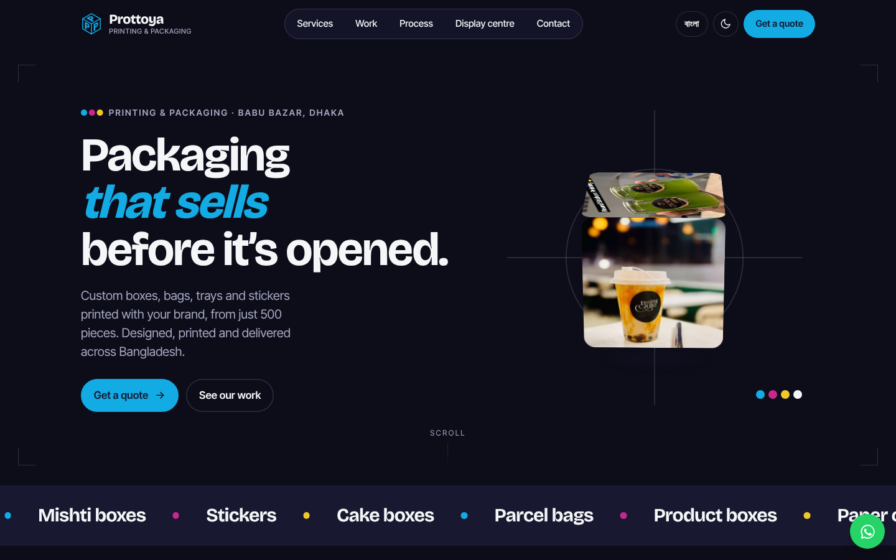
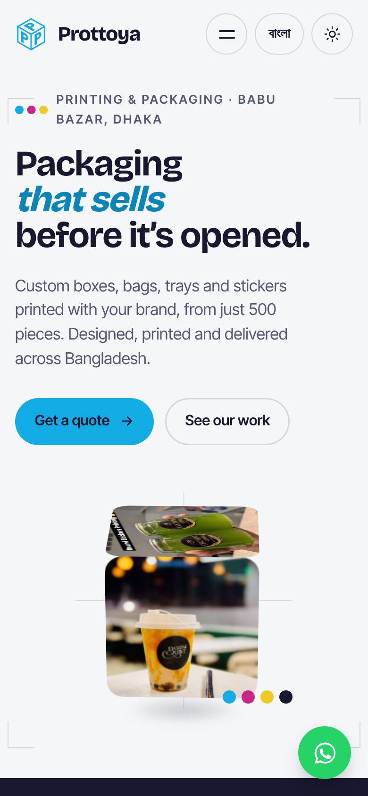
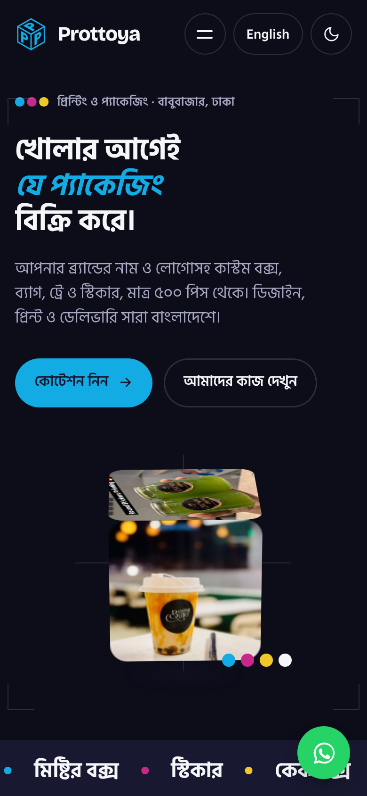
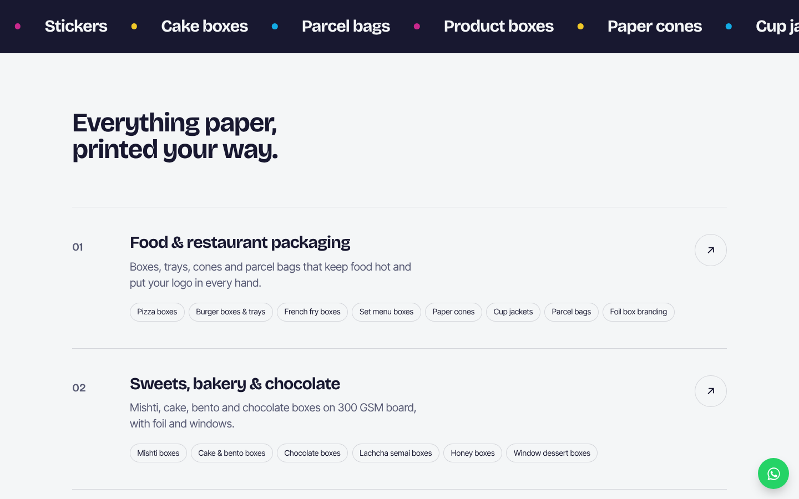
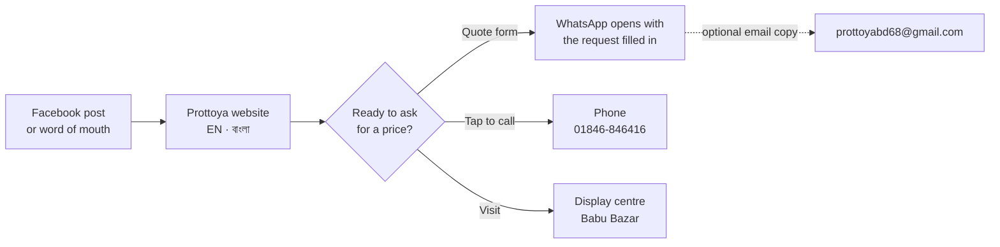
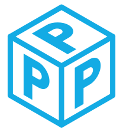

<p align="center">
  <a href="https://prottoya.vercel.app"></a>
</p>

<p align="center">
  <a href="https://prottoya.vercel.app"></a>
  <a href="https://astro.build"></a>
  <a href="https://gsap.com"></a>
  <a href="https://lenis.darkroom.engineering"></a>
  
  
</p>

<p align="center">
  <a href="https://prottoya.vercel.app"><b>Visit the site</b></a> ·
  <a href="https://prottoya.vercel.app/bn/">বাংলা সংস্করণ</a> ·
  <a href="https://www.facebook.com/ProttoyaPrintingPackaging">Facebook</a> ·
  <a href="https://wa.me/8801846846416">WhatsApp</a>
</p>

This is the website of **Prottoya Printing & Packaging**, a custom paper printing and packaging maker in Babu Bazar, Dhaka. Food businesses, sweet shops, bakeries and retail brands order boxes, bags, trays and stickers printed with their own branding, from about 500 pieces, with design help and delivery across Bangladesh.

The site shows what Prottoya makes, proves it with real jobs from their Facebook page, and turns a visit into a quote request on WhatsApp, by phone or through the form. It reads in English and Bangla, in light and dark, and moves the way good packaging feels in the hand: smooth, tactile and a little playful.

<p align="center">
  <a href="https://prottoya.vercel.app"></a>
</p>

## Highlights

| | |
| --- | --- |
| 🧊 **3D logo cube** | The hero's cube is the Prottoya mark folded into a box. It turns with the cursor and shows real jobs on its faces. |
| 🎞️ **Speed-reactive marquees** | Product names run across the page and speed up, slow down and reverse with your scroll. |
| 🖼️ **Horizontal work gallery** | A pinned, sideways-scrolling strip of real boxes, stickers and bags, with a photo that follows the cursor. |
| 🧲 **Magnetic buttons** | Calls to action lean toward the pointer before you click. |
| 🌗 **Light and dark** | One toggle, remembered per visitor, with the system setting as the default. |
| 🇧🇩 **English and বাংলা** | Every word is written for both languages, at `/` and `/bn/`, with a switch in the header. |
| 💬 **Quote in one tap** | The quote form opens WhatsApp with the request filled in and can email a copy too. A floating WhatsApp button stays in reach on every screen. |
| ⚡ **Fast on a phone** | Static pages, optimised WebP images, self-hosted fonts and inlined CSS. Lighthouse scores 97 on mobile and 100 on desktop. |
| ♿ **Calm when asked** | All motion steps back for visitors who set "reduce motion" on their device. |

## A look around

<table>
  <tr>
    <td width="50%"></td>
    <td width="50%"></td>
  </tr>
  <tr>
    <td align="center"><sub>Light theme</sub></td>
    <td align="center"><sub>Dark theme</sub></td>
  </tr>
</table>

<table>
  <tr>
    <td width="25%"></td>
    <td width="25%"></td>
    <td width="50%"></td>
  </tr>
  <tr>
    <td align="center"><sub>Phone, English</sub></td>
    <td align="center"><sub>Phone, বাংলা, dark</sub></td>
    <td align="center"><sub>Services</sub></td>
  </tr>
</table>

## How a visit becomes an order



## What Prottoya makes

<details>
<summary><b>Food & restaurant packaging</b></summary>

Pizza boxes, burger boxes and trays, French fry boxes, set menu boxes, paper cones, cup jackets, parcel bags and foil box branding.
</details>

<details>
<summary><b>Sweets, bakery & chocolate</b></summary>

Mishti boxes, cake and bento boxes, chocolate boxes, lachcha semai boxes, honey boxes and window dessert boxes, typically on 300 GSM board with foil and windows.
</details>

<details>
<summary><b>Retail boxes & print</b></summary>

Product boxes, mobile accessory boxes, apparel and shoe boxes, rigid gift boxes, paper shopping bags, hang tags, calendars, and memo and receipt books.
</details>

<details>
<summary><b>Stickers & labels</b></summary>

Round stickers, logo stickers, waterproof glossy labels, cup and glass stickers, and jar labels.
</details>

The full lists, in both languages, live in [`src/data/site.ts`](src/data/site.ts).

## Built with

| Layer | Choice | Why |
| --- | --- | --- |
| Framework | [Astro](https://astro.build) | Static HTML with almost no JavaScript, so pages open fast on mobile data. |
| Motion | [GSAP](https://gsap.com) + ScrollTrigger | The cube, marquees, pinned gallery and reveals. |
| Scrolling | [Lenis](https://lenis.darkroom.engineering) | Smooth, inertial scrolling that stays in sync with the animations. |
| Type | Bricolage Grotesque, Inter Tight, Hind Siliguri | Latin fonts are self-hosted at build time with size-matched fallbacks; Hind Siliguri carries the Bangla text. |
| Hosting | [Vercel](https://vercel.com) | Static hosting plus one serverless function for quote emails. |
| Email | [Resend](https://resend.com) (optional) | Sends a copy of each quote request. |

The palette comes straight from the logo:


## Run it locally

You need Node.js 22.12 or newer.

```sh
git clone https://github.com/thesturag/website-prottoya-printing-packaging.git
cd website-prottoya-printing-packaging
npm install
npm run dev        # http://localhost:4321 (Bangla at /bn/)
```

| Command | What it does |
| --- | --- |
| `npm run dev` | Starts the dev server with hot reload. |
| `npm run build` | Builds the static site into `dist/`. |
| `npm run preview` | Serves the built site to check it before deploying. |

## Edit the content

Almost every change happens in one file.

| To change | Edit |
| --- | --- |
| Any text, in English or Bangla | [`src/data/site.ts`](src/data/site.ts) |
| Phone, WhatsApp, email, address, map link | `contact` at the top of [`src/data/site.ts`](src/data/site.ts) |
| Services and their item lists | `services` in [`src/data/site.ts`](src/data/site.ts) |
| Which photos appear in the gallery | `work` in [`src/data/site.ts`](src/data/site.ts) (numbers match files in `src/assets/work/`) |
| Colours, type sizes, spacing | [`src/styles/tokens.css`](src/styles/tokens.css) |
| Motion (cube, marquee, gallery, theme, form) | [`src/scripts/main.ts`](src/scripts/main.ts) |

<details>
<summary><b>Project structure</b></summary>

```text
.
├── api/
│   └── quote.js            Vercel function that emails quote requests
├── archive/                Every photo collected from Facebook, kept out of the build
├── docs/media/             Images used in this README
├── public/                 Favicon, logo mark, social card, robots and sitemap
├── src/
│   ├── assets/work/        Photos used on the page, converted to WebP at build
│   ├── components/         Header, Hero, Marquee, Services, Work, Process, Contact, Footer
│   ├── content/            Facebook page data the copy was written from
│   ├── data/site.ts        All copy (EN and BN), services, gallery picks and contacts
│   ├── layouts/Base.astro  HTML shell, meta tags, theme bootstrap
│   ├── pages/              index.astro (English) and bn/index.astro (Bangla)
│   ├── scripts/main.ts     Smooth scroll and every animation
│   └── styles/             Design tokens and global styles
├── PRODUCT.md              Who the site is for and what it must do
└── astro.config.mjs        Site URL, fonts and build options
```
</details>

## Deploy

The site is a Vercel project. Each push to a pull request gets its own preview link, and `main` deploys to production.

To have the quote form email a copy of every request, add these in Vercel under **Project → Settings → Environment Variables** (see [`.env.example`](.env.example)):

| Variable | Purpose |
| --- | --- |
| `RESEND_API_KEY` | Turns on the email copy. Without it, the form still opens WhatsApp. |
| `QUOTE_TO` | Inbox that receives requests. Defaults to `prottoyabd68@gmail.com`. |
| `QUOTE_FROM` | Sender address on a domain verified in Resend. |

## Contact Prottoya

| | |
| --- | --- |
| 📞 Phone | [01846-846416](tel:+8801846846416) |
| 💬 WhatsApp | [+880 1846-846416](https://wa.me/8801846846416) |
| ✉️ Email | [prottoyabd68@gmail.com](mailto:prottoyabd68@gmail.com) |
| 📍 Display centre | [18, Sayed Hasan Ali Lane, Babu Bazar, Dhaka 1100](https://www.google.com/maps/search/?api=1&query=18+Sayed+Hasan+Ali+Lane+Babu+Bazar+Dhaka+1100) |
| 👍 Facebook | [ProttoyaPrintingPackaging](https://www.facebook.com/ProttoyaPrintingPackaging) |

---

<p align="center">
  <br>
  <sub>Photos of real jobs © Prottoya Printing & Packaging. Website built by <a href="https://github.com/thesturag">@thesturag</a>.</sub>
</p>
